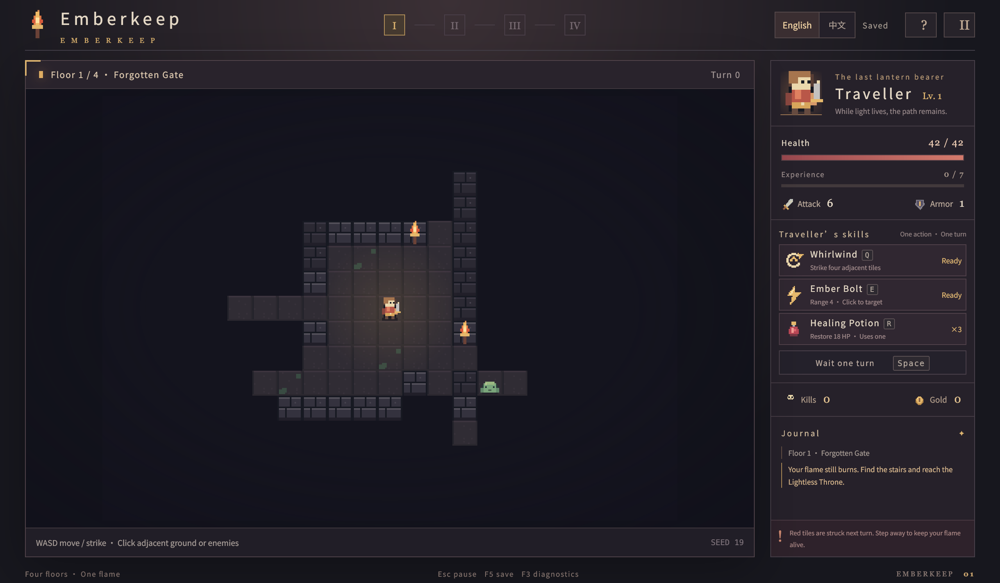

# Emberkeep

English · [简体中文](README.zh-CN.md)

Emberkeep is a desktop pixel roguelike with turn based combat. Carry a lantern through four randomly generated dungeon floors, find the stairs, defeat the Lightless Warden, and escape into daylight.

Slimes move slowly, Bone Sentinels pursue you, and Ash Cultists keep their distance while charging spells. Fight with melee attacks, Whirlwind, Ember Bolt and healing potions. Gain experience and choose one of three random upgrades. The game includes a main menu, pause screen, upgrades, victory and defeat screens, and save continuation.

It is also a demo of `ultralight-py 0.5.0`: Python owns the rules; JavaScript draws the Canvas and UI. Registered functions, live object proxies and Promises connect them.



## Run

Requires Python 3.10+ and a graphical desktop.

```bash
python -m pip install -r requirements.txt
python run.py
```

Alternatively, use `uv run python run.py`. Options: `--cpu` for CPU rendering, `--seed 19` for a fixed dungeon seed, and `--data-dir ./local-save` for a custom save directory.

Choose English or 简体中文 in the top right corner; your preference is remembered. `--lang en` or `--lang zh-CN` overrides that preference at startup.

The atlas, font and page resources ship with the game. No server or network is needed. Every valid action automatically saves to `~/.emberkeep/save.json`. The pause menu lets you save and return; the main menu continues an unfinished adventure.

## Download and release builds

GitHub Releases provide Windows x64 and macOS Apple Silicon ZIPs; Python is not required.
On Windows, extract the entire archive and open `Emberkeep/Emberkeep.exe`.
On macOS, extract and open `Emberkeep.app`. The App is ad-hoc signed without Apple Developer signing or notarization; if macOS blocks it, attempt to launch it, then use **System Settings → Privacy & Security → Open Anyway**.
Intel Macs are not supported by these bundles. Save files use the same `~/.emberkeep` directory as source builds.

Push a tag matching the version in `pyproject.toml` (currently `v1.0.0`) to build both platforms. Only after tests and both extracted ZIPs pass verification does CI automatically create the Release with the two ZIPs and `SHA256SUMS.txt`. Re-running a successful tag build replaces its release assets.
Manual runs of **Build desktop releases** provide Actions artifacts for 14 days, with a commit suffix in the filenames; they do not publish a Release.

To reproduce a build on Windows x64 or macOS ARM64 with Python 3.12:

```bash
python -m pip install -r requirements-build.txt
python -m pytest -q
python tools/build_release.py --tag v1.0.0
```

Verified ZIPs and individual checksums appear in `dist/releases/`; smoke reports and logs are in `build/diagnostics/`. The build checks English and Chinese UI startup, the native bridge and save/load from the extracted application with an isolated save. It requires a graphical desktop.
For diagnostics, use `--smoke --cpu --smoke-report result.json`; the report records success or failure, and failure exits nonzero. Windows windowed logs are stored in `~/.emberkeep/emberkeep.log`.

## Controls

| Input | Action |
| --- | --- |
| WASD / arrows | Move; bump enemies to strike |
| Mouse click | Move to adjacent ground; melee adjacent enemies; cast Ember Bolt at distant enemies |
| Q / E / R | Whirlwind / Ember Bolt / healing potion |
| Space | Wait one turn |
| 1 / 2 / 3 | Choose an upgrade |
| Esc / F5 | Pause / save |
| F3 | Bridge diagnostics |

Red warning tiles are struck next turn: move away. Walls and unavailable skills do not consume a turn. Losing window focus pauses the adventure; resume when you return.

## Implementation

- [`game/engine.py`](game/engine.py): state, combat, AI, growth and endings. Explicit action methods share one turn boundary.
- [`game/bridge.py`](game/bridge.py): typed bridge. `Controller.register_api()` installs 13 explicit APIs and exposes live state and instance commands through `register_object`.
- [`run.py`](run.py): native AppCore window, asyncio loop and `resource_loader`; [`assets/`](assets/) supplies rendering and UI.
- [`game/storage.py`](game/storage.py): asynchronous, versioned JSON saves with RNG state and atomic replacement.

The keyboard calls registered functions such as `host.move('right')`; the skill bar and mouse call instance methods such as `host.game.whirl()`. The HUD reads live, read-only properties such as `host.game.hero.hp`; `Python.to_value()` copies render snapshots. See [`assets/bridge.d.ts`](assets/bridge.d.ts) for the frontend interface.

Text lives in [`assets/locales/`](assets/locales/). Python returns translated display snapshots; logs store keys and parameters. Language changes consume no turns and leave RNG untouched. Older Chinese saves retain gameplay state; their text history is replaced by a continuation notice.

## Tests

```bash
python -m pip install -r requirements-dev.txt
python -m pytest -q
python run.py --smoke
```

Rule tests, three native winning campaigns and a natural defeat were validated with the real 0.5.0 runtime. See [validation](docs/VALIDATION.md) for results and limits, and [`docs/screenshots/`](docs/screenshots/) for native captures.

Code and original pixel art are MIT licensed. The bundled Noto Sans SC font uses OFL; see `assets/font-license.txt`. ultralight-py and Ultralight/AppCore retain their own licenses.
