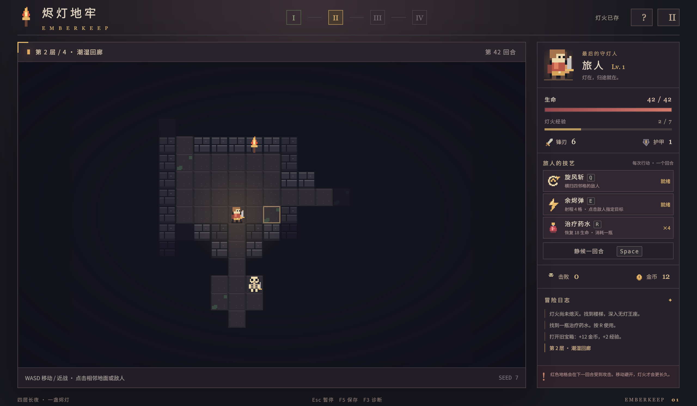

# 烬灯地牢 · Emberkeep

《烬灯地牢》是一款像素风桌面回合制 Roguelike。你扮演一名守灯旅人，探索四层随机生成的地牢，寻找通往下一层的楼梯，最终击败无灯守墓者并从出口离开。

敌人的行动方式各不相同：软泥缓慢靠近，白骨哨兵持续追击，术士保持距离并蓄力施法。你可以使用近战、旋风斩、余烬弹和治疗药水应对战斗；积累经验后，从随机提供的三项强化中选择一项。游戏包含主菜单、暂停、升级、胜负结算和存档继续。

这个项目也是 `ultralight-py 0.5.0` 的应用示例：Python 负责游戏规则，JavaScript 负责 Canvas 画面与界面，通过函数注册、实时对象代理和 Promise 协作。



## 运行

需要 Python 3.10+ 和图形桌面。

```bash
python -m pip install -r requirements.txt
python run.py
```

也可以使用 `uv run python run.py`。启动参数：`--cpu` 使用 CPU 渲染，`--seed 19` 固定地图种子，`--data-dir ./local-save` 指定存档目录。

图集、字体和页面资源均随项目提供，游戏运行不需要服务器或网络。默认存档为 `~/.emberkeep/save.json`，每次有效行动后自动保存；暂停菜单可以保存并返回，主菜单可以继续冒险。

## 操作

| 操作 | 用途 |
| --- | --- |
| WASD / 方向键 | 移动，撞敌近战 |
| 鼠标点击 | 相邻地面移动；相邻敌人近战；远处敌人施放余烬弹 |
| Q / E / R | 旋风斩 / 余烬弹 / 治疗药水 |
| Space | 等待一回合 |
| 1 / 2 / 3 | 选择升级 |
| Esc / F5 | 暂停 / 保存 |
| F3 | 桥接诊断 |

红色预警将在下一回合触发攻击，及时移动避开。撞墙或技能不可用不消耗回合。窗口失焦会暂停，返回后需主动继续。

## 实现

- [`game/engine.py`](game/engine.py)：地图状态、战斗、AI、成长与胜负；移动、技能和交互分别实现为明确方法，共享回合收尾逻辑。
- [`game/bridge.py`](game/bridge.py)：带类型标注的桥接层；`Controller.register_api()` 注册 12 个独立 API，并通过 `register_object` 暴露游戏状态和实例方法。
- [`run.py`](run.py)：AppCore 原生窗口、asyncio 循环和 `resource_loader`；[`assets/`](assets/) 提供渲染与 UI。
- [`game/storage.py`](game/storage.py)：异步读写带版本的 JSON 存档，保存包含随机数状态，使用原子替换。

键盘调用注册函数，例如 `host.move('right')`；技能栏和鼠标调用实例方法，例如 `host.game.whirl()`。HUD 读取 `host.game.hero.hp` 等实时只读属性，绘制快照通过 `Python.to_value()` 获取。前端接口声明见 [`assets/bridge.d.ts`](assets/bridge.d.ts)。

## 测试

```bash
python -m pip install -r requirements-dev.txt
python -m pytest -q
python run.py --smoke
```

已在真实 0.5.0 环境完成规则测试、三个种子的原生通关和自然失败。详细结果与未验证项见 [验证记录](docs/VALIDATION.md)，实际原生截图位于 [`docs/screenshots/`](docs/screenshots/)。

源码与原创像素图集使用 MIT；随包 Noto Sans SC 字体使用 OFL，许可证位于 `assets/font-license.txt`。ultralight-py 和 Ultralight/AppCore 遵循各自许可证。
